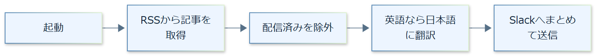

# Azure News Notifier

Azureの更新情報・サポートブログをRSSから集め、英語のタイトルと概要だけを日本語にしてSlackへ届けます。
1日1回の配信、月50円以内を目標にした小規模な構成です。

## RSSと処理の流れ

RSSは、サイトがXMLで公開する記事一覧です。このアプリが定期的にHTTP GETで取得する「ポーリング」で、RSS側からのプッシュではありません。
配信済みURLを保存して、同じ記事の再配信を避けます。全文の取得・翻訳は行いません。



## 読む場所

- 全体と設定：[設計](docs/design.md)。論理構成・Azure構成・処理フローの図もここにあります。
- 通常の処理：`app/notifier/core.py`。収集→重複除外→翻訳→通知→保存の順番です。
- ローカル確認：`app/local_check.py`。デモや接続確認を通常処理から分けています。
- 自動テスト：`app/tests/`。公開するコードの動作を確認するものです。

## ローカルで確認する

Python 3.11以上を使います。以下はPowerShellで、リポジトリのappフォルダーから実行します。

```powershell
python -m venv .venv
.venv/Scripts/python -m pip install -e '.[dev,azure]'
.venv/Scripts/python -m pytest -q
```

`.venv` はこのアプリ専用のライブラリ置き場です。仮想マシンではなく、GitやAzureの配置対象にも含めません。
RSSだけを実取得する場合は `python local_check.py --check-feeds` です。Azure認証や通知は行いません。

## 翻訳してSlackへ1記事送る

`app/.env.example` を `app/.env` へコピーし、次の3項目を設定します。

|設定|入れる値|
|---|---|
|FOUNDRY_ENDPOINT|Foundry / Azure OpenAIのエンドポイント|
|FOUNDRY_DEPLOYMENT|作成したモデルのデプロイ名|
|SLACK_WEBHOOK_URL|Slack Incoming WebhookのURL|

`.env` は自動で読み込みます。既存の環境変数が優先されます。秘密の実値はGitへ入れません。
Azure CLIでログインした開発者に、対象FoundryのCognitive Services OpenAI Userが必要です。
APIキーは使いません。Functions上では開発者の代わりにManaged Identityを使います。

```powershell
az login
.venv/Scripts/python local_check.py --smoke-test
```

実RSSの未配信の英語記事を1件翻訳して送ります。Slackで日本語のタイトル・概要、通知先、記事リンクを確認してください。
通常配信は `python local_check.py --live` です。接続確認も月30回の翻訳枠を消費します。

## Azureへの配置

現時点ではローカル配信部分までです。FunctionsのタイマーとBlobの永続化・排他を追加してから配置します。
Bicepは今後infra/へ追加します。LINE送信も未実装です。
