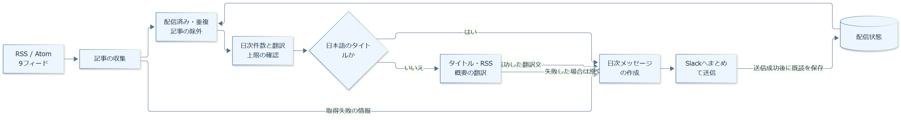
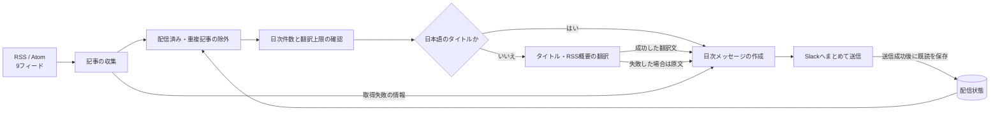
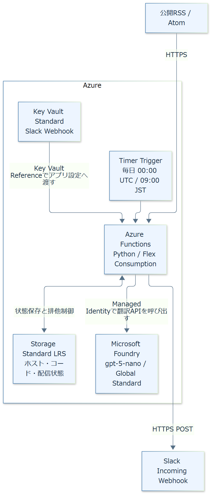
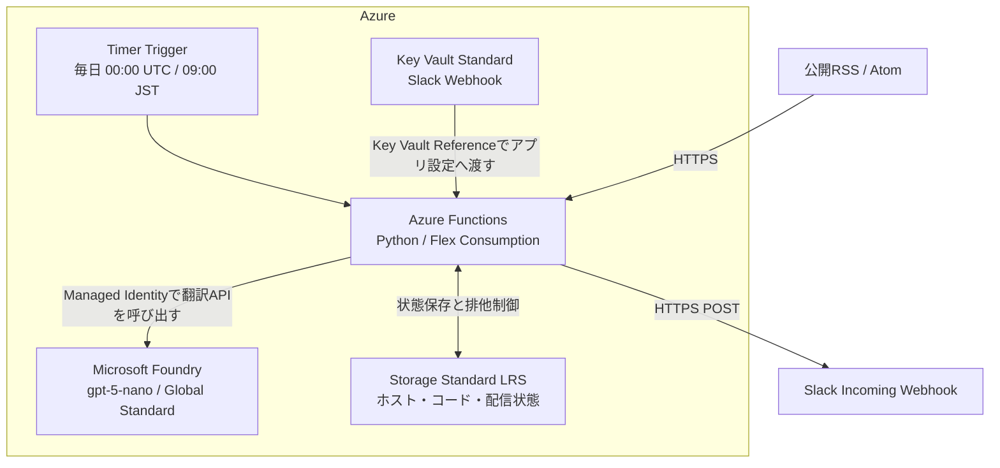
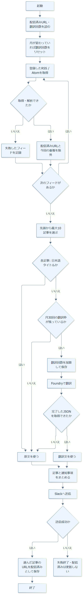
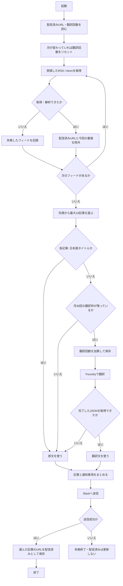

# 設計

RSSのタイトル・概要・リンクを収集し、英語の短文だけを翻訳して1日1回Slackへ配信します。
記事本文の取得・翻訳や検索DBは扱いません。

## 論理構成

編集用Mermaid

## Azure上の構成

編集用Mermaid

## 処理フロー

編集用Mermaid

## アプリの役割

`app/notifier/` が通常処理、`app/local_check.py` がローカル確認、`app/tests/` が自動テストです。

|通常処理のファイル|役割|
|---|---|
|core.py|収集→重複除外→翻訳→通知→既読保存の順番|
|feed_parser.py|RSS / AtomのXMLから記事を取り出す|
|translation.py|Foundryでタイトル・概要を日本語にする|
|notifications/slack.py|Slackの表示形式と送信。LINEは将来ここへ追加|
|state_store.py|配信済みURLと月間翻訳回数をJSONへ保存|
|http_client.py|HTTPS通信の共通制限|
|models.py|記事・配信状態・配信結果のデータ型|

デモ、RSSだけの確認、1記事の接続確認はlocal_check.pyへ分離しています。
既存の `python -m notifier` も互換の起動口として残しています。

## リソース設定

名前は公開用の例です。リソースの実名やIDはソースへ入れません。

|対象|名前の例|設定|
|---|---|---|
|Resource Group|rg-azure-news-dev|関連リソースをまとめる|
|Foundry|ai-azure-news-dev-xxxx|gpt-5-nano、2025-08-07、Global Standard、TPM 1000、DefaultV2|
|モデル更新|—|現在バージョンの有効期限が切れたら更新|
|Key Vault|kv-aznews-dev-xxxx|Standard、RBAC、Webhookをslack-webhookとして保管|
|Storage|staznewsdevxxxx|StorageV2、Standard LRS、匿名公開無効、HTTPS必須|
|Function App|func-azure-news-dev-xxxx|Linux / Python 3.12候補 / Flex Consumption、Always Ready 0|
|Timer|daily_news|`0 0 0 * * *`：UTC 00:00、JST 09:00|

FunctionsとBlobへの保存処理は未実装です。現状のローカル版はJSONファイルを使います。
Azure移行時は、状態をBlobへ保存し、leaseによる排他を追加します。

## 認証

|実行場所|Foundryを呼ぶ主体|必要な権限|
|---|---|---|
|ローカル|Azure CLI等でログインした開発者|対象FoundryのCognitive Services OpenAI User|
|Azure Functions|FunctionsのManaged Identity|同じロールをFunctions自身へ割り当てる|

開発者の認証情報をFunctionsへコピーしません。
FunctionsのWebhookはKey Vault Referenceで渡し、IDにはKey Vault Secrets Userを付与します。
状態BlobにはStorage Blob Data Contributorを付与します。Functionsホスト用Storageの設定・権限は別途必要です。

## 上限と失敗時の動作

- 9フィード、1回最大10記事、翻訳は失敗を含め月30回。月の区切りはJST。
- 翻訳入力はタイトル120文字・概要300文字、出力400トークン。推論分も出力に含む。
- HTTPは30秒、最大4MB。危険なXMLを拒否し、記事本文へはアクセスしない。
- 日本語タイトルは翻訳しない。取得したURLの完全一致で重複を除外する。
- 翻訳回数はAPIの前に保存。既読はSlack送信の後に保存する。
- 通常配信の翻訳失敗は原文で継続。接続確認では翻訳失敗時に送信せず停止する。
- 初回はRSS内の過去記事も対象。上限超過分は次回のRSSに残っていれば再取得する。
- 送信直後の保存失敗では重複の可能性がある。状態破損時は処理を停止する。
- アプリ停止やSlack自体の障害は同じSlackへ通知できない。独立監視は追加設計が必要。

## 料金の目安

月30記事、入力500・出力400トークン/記事、入力$0.05・出力$0.40/100万トークン、1ドル150円を仮定すると、翻訳は約0.83円/月です。
仮単価・税別の計算例であり、契約価格は構築時に確認します。
Functionsの無料枠が残り、Storage 0.1GB・月10,000操作、Key Vault月100操作を仮定した従来の概算は全体約8.8円/月です。
Storage操作などは未実測で、月50円以内の保証ではありません。Always Ready、有料の独立監視、多量のログは含めません。

参考（日本語）: [Functions](https://learn.microsoft.com/ja-jp/azure/azure-functions/flex-consumption-plan)、[Key Vault Reference](https://learn.microsoft.com/ja-jp/azure/app-service/app-service-key-vault-references)、[Foundry API](https://learn.microsoft.com/ja-jp/azure/foundry/openai/api-version-lifecycle)、[料金表](https://azure.microsoft.com/ja-jp/pricing/details/azure-openai/)。
