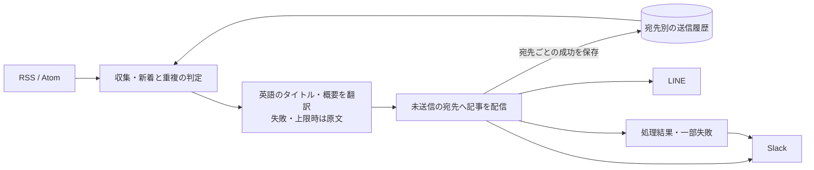
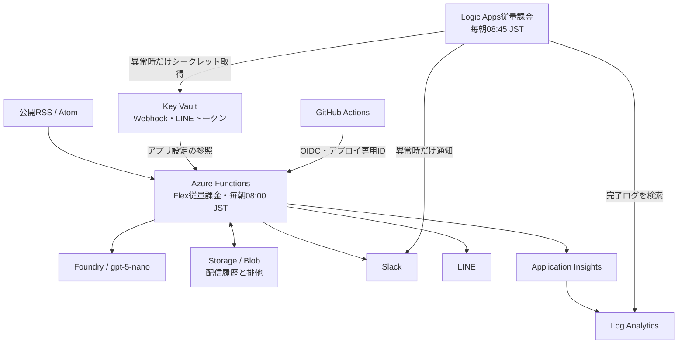
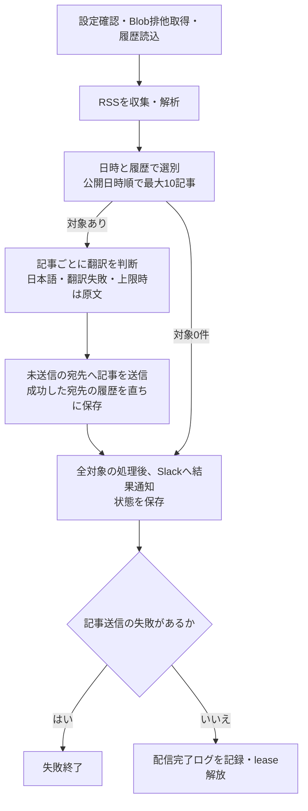

# 設計

## 対象としない処理

RSS / Atomのタイトル・概要・リンク・公開日時を使います。記事本文の取得、全文翻訳、検索DB、サイト別のキーワード選別は行いません。登録したフィードの記事が対象です。

## 論理構成

図のMermaidソース

翻訳結果は同じ実行内でSlack・LINEに共用します。記事は1件ずつ投稿し、処理結果はSlackだけへ通知します。送信履歴を宛先別に持つため、片方だけ失敗した記事は未送信側だけ再試行できます。

## Azure上の構成

図のMermaidソース

Functionsは配信処理、Logic Appsは外からの完了確認を担当します。同じFunction App内に監視を置くと、アプリ全体の停止時に監視も止まるため分けています。監視用のアラートルール・アクショングループは追加せず、検索・判定・通知をLogic Appsにまとめます。

## 処理フロー

図のMermaidソース

保存や排他の失敗など、処理を安全に続けられない例外では停止します。翻訳失敗は原文で継続し、記事送信が失敗した場合も別の宛先へは送信を続けます。送信済みURLは削除してテストせず、実際の再配信が起きる状態変更として扱います。

## リソースの設定

名前は公開用の例です。`dev` は環境、`jpe` はJapan Eastを表します。ストレージとKey Vaultの名前は利用者ごとに一意にしてください。

| リソース | 名前の例 | 設定・役割 |
|---|---|---|
| Resource Group | `rg-azurenews-dev-jpe-001` | Japan East、関連リソースを集約 |
| Foundry | `aif-azurenews-dev-jpe-001` | gpt-5-nano / 2025-08-07 / Global Standard / TPM1000 / DefaultV2 |
| Foundryプロジェクト | `prj-azurenews-dev-001` | モデル直接呼び出しに必須ではないが、プロジェクト管理用に保持 |
| モデル更新 | — | 現在のバージョンの有効期限が切れたら更新 |
| Key Vault | `kv-azurenews-dev-jpe-001` | Standard、RBAC、`slack-webhook-url`・`line-channel-access-token` |
| Storage | `stazurenewsdevjpe001` | StorageV2、Standard LRS、匿名公開無効、TLS1.2以上 |
| 状態コンテナー | `notifier-state` | 非公開。`state.json` はアプリが作成する |
| Functionsプラン | Portal生成名 | Flex従量課金、Always Ready 0 |
| Function App | `func-azurenews-dev-jpe-001` | Linux / Python3.12 / 512MB / システム割り当てID |
| Timer | `daily_news` | `0 0 23 * * *`：UTC23:00＝翌日JST08:00、起動時の自動実行なし |
| 実行時間 | — | `host.json` で最大20分 |
| Application Insights | `appi-azurenews-dev-jpe-001` | 下記ワークスペースへログを保存 |
| Log Analytics | `log-azurenews-dev-jpe-001` | アプリログの保存・KQL検索 |
| デプロイ用ID | `id-azurenews-deploy-dev-jpe-001` | ユーザー割り当てID、GitHub ActionsのOIDC認証用 |
| Logic Apps | `logic-azurenews-dev-jpe-001` | 従量課金・ステートフル、毎朝08:45 JST、システム割り当てID |

Functionsホスト、デプロイパッケージ、配信状態は同じストレージアカウント内の別用途として管理します。`feeds.json` はアプリに同梱し、状態コンテナーには置きません。

## 設定と認証

| Functionsの環境変数 | 内容 |
|---|---|
| `FOUNDRY_ENDPOINT` / `FOUNDRY_DEPLOYMENT` | モデルAPIの接続先とデプロイ名。APIキーは使わない |
| `SLACK_WEBHOOK_URL` | Key Vault Referenceで渡す |
| `LINE_CHANNEL_ACCESS_TOKEN` | Key Vault Referenceで渡す |
| `LINE_RECIPIENT_ID` | LINEの送信先ID。トークンと両方ある場合だけLINEを有効化 |
| `STATE_BLOB_URL` | SASなしの状態Blob URL |
| `DELIVERY_START_AT` | 配信を開始する固定日時。タイムゾーン付きISO形式、未設定なら停止 |

ローカル確認では開発者のAzure CLI等の認証を使います。Azure上はFunctions自身のマネージドIDだけを使い、開発者の資格情報へフォールバックしません。

FunctionsのIDは対象Foundryの `Cognitive Services OpenAI User`、Key Vaultのシークレット読み取り、Blobの読み書きとlease操作に必要な権限を持ちます。ホスト・デプロイ用ストレージの権限も別途必要です。監視用Logic AppsのIDは対象ワークスペースの `Log Analytics Reader` とSlack用シークレットの `Key Vault Secrets User` を使います。

GitHubの `dev` Environmentには `AZURE_CLIENT_ID`、`AZURE_TENANT_ID`、`AZURE_SUBSCRIPTION_ID` をSecrets、`DEPLOY_ENV=dev` をVariablesとして設定します。クライアントIDはデプロイ用ユーザー割り当てIDのものです。ID自体はパスワードではありませんが、公開YAMLへの実値の固定を避けています。

IDのフェデレーション資格情報はGitHubの対象リポジトリ・Environmentに限定します。アプリの実行用IDとデプロイ用IDは分離します。現在はfeatureブランチからdevへ配置しており、mainへ取り込む際にワークフローの起動ブランチを見直します。prd環境はまだ構築していません。

## 上限と失敗時の動作

- 登録RSSは1〜9件、記事は1回最大10件。再実行で枠が戻るため、厳密な1日累計上限ではありません。
- 翻訳は失敗を含め月30回。API呼び出し前に加算して保存し、月替わりに回数だけリセットします。
- タイトル120文字・RSS概要300文字までを翻訳へ渡し、出力上限は400トークン。呼び出し間隔は61秒です。
- 配信開始前・未来・日時不明の記事は通常配信から除外します。上限超過分は次回のRSSに残っていれば再取得します。
- HTTPは待ち時間30秒・応答最大4MB。危険なXMLを拒否し、HTMLの本文取得や任意のリダイレクト追従は行いません。
- Blob leaseは60秒、20秒ごとに更新し、排他を失った実行の翻訳・送信を防ぎます。
- 送信受付直後に通信や保存が失敗すると、重複する可能性があります。完全な一度限りの配信は保証しません。

## 監視と確認場所

Functionsは `Azure news delivery result:` に詳細件数、配信本体が戻った後に `Azure news delivery completed:` を記録します。一部取得・翻訳失敗でも完了ログは出るため、完了ログは「全件成功」の証明ではありません。

Logic Appsは08:45に、本日08:00以降の対象Application Insightsの完了ログを検索します。

| 検索結果 | 動作 |
|---|---|
| 完了ログ1件以上 | 通知なし。記事0件の完了も正常 |
| 検索成功・完了ログ0件 | `⚠️【Azure Functions】` として完了未確認をSlackへ通知 |
| 検索失敗・タイムアウト | `⚠️【Logic Apps】` として配信状況未確認をSlackへ通知 |

ログ検索APIのURIは `https://api.loganalytics.azure.com/v1/workspaces/<ワークスペースID>/query`、Audienceは `https://api.loganalytics.io` です。ワークスペース名ではなくGUIDを使います。

Webhookは通知が必要な場合だけKey Vaultから取得します。取得・送信HTTPのSecure inputs / outputsを有効にし、送信HTTPは重複防止のため再試行なしとします。一時的な通信失敗での自動再送はありません。

この監視では手動実行の完了ログも数えるため、タイマー起動の証明にはなりません。ログ収集の遅延は誤警告につながり、Logic Apps自体の停止・Key VaultやSlackの障害では通知できません。応答のCompletedが欠落した場合も現在の式では0扱いになります。Azure Monitorのアラート一覧・発生解決の状態管理は使いません。既存のSmart Detectionはこの監視とは別です。

## 費用の前提

翻訳の計算例は、月30記事・入力500トークン/記事・出力400トークン/記事・入力100万トークンあたり$0.05・出力$0.40・1ドル150円と仮定すると、`30 × (500 × 0.05 + 400 × 0.40) ÷ 1,000,000 × 150 ≒ 0.83円/月` です。これは仮単価による例で、実際の入力には指示文等も含みます。

全体はFunctionsの実行・メモリ時間、Storageの容量・操作、Key Vaultの操作、ログの取り込み・保持、Logic Appsの実行、LINEの配信プランを合わせて評価します。無料枠は他の利用と共有される場合があります。月50円は目標であり、実測前の保証額ではありません。

監視は有料の定期ログアラートを使わず、Logic Appsの組み込みHTTPで1日1回だけ確認します。Always Readyは0とし、ログは必要なアプリ情報に絞ります。料金の判定はCost Managementの実績と各サービスの契約価格で行います。

## 検証と担当

単体・モック結合テストは `tests/` に置き、仮のRSS、翻訳、送信、保存を使って日付選別・重複除外・上限・宛先別の失敗と再送を検証します。これは実際の認証・接続・端末受信の証明とは別です。devではRSS取得、Foundry翻訳、Slack・LINEへの配信、Blob保存を実接続で確認しています。

監視は検索失敗時のSlack通知と、完了ログありの場合の通知なしを確認済みです。検索成功・完了ログ0件の強制テストは省略しています。

差分の作成・ローカル検証と、実環境の設定・実受信の確認を分けて進めます。リソース設定・権限・秘密情報は環境の管理者が確認し、コミット・プッシュ・PRレビュー・マージはリポジトリの管理者が行います。

## 参考資料（日本語）

- [Azure Functions Flex従量課金](https://learn.microsoft.com/ja-jp/azure/azure-functions/flex-consumption-plan)
- [Key Vault参照](https://learn.microsoft.com/ja-jp/azure/app-service/app-service-key-vault-references)
- [Logic AppsのマネージドID認証](https://learn.microsoft.com/ja-jp/azure/logic-apps/authenticate-with-managed-identity)
- [Log Analytics APIの認証](https://learn.microsoft.com/ja-jp/azure/azure-monitor/logs/api/access-api)
- [Azure Monitor料金](https://azure.microsoft.com/ja-jp/pricing/details/monitor/)、[Logic Apps料金](https://azure.microsoft.com/ja-jp/pricing/details/logic-apps/)、[モデル料金](https://azure.microsoft.com/ja-jp/pricing/details/azure-openai/)
